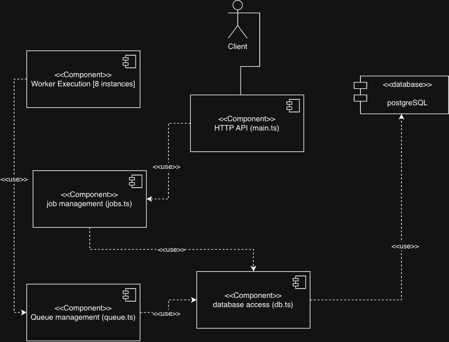
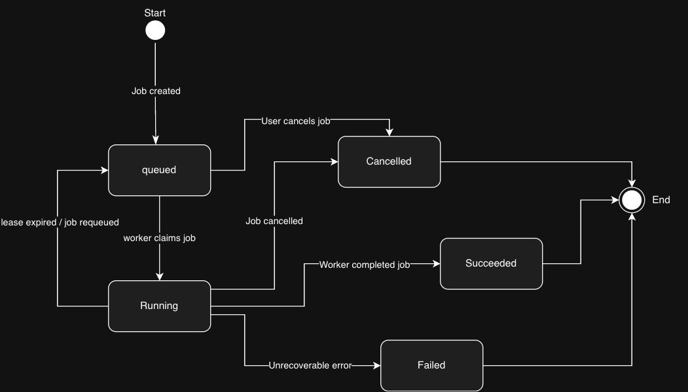

# Soup Task — Reliable Job Queue

A TypeScript and PostgreSQL backend for creating, monitoring, processing, and cancelling simulated jobs. The system runs an HTTP API alongside eight independent worker processes. It is designed to explore concurrent job claiming, idempotent job creation, lease-based crash recovery, and safe database state transitions.

## Technology Stack

- TypeScript / Node.js — HTTP API, worker processes, and test harnesses.
- PostgreSQL — durable job state, transactional claiming, leases, and execution records.
- `pg` — PostgreSQL connection pooling and SQL queries.
- Docker / Docker Compose — database, API, and eight worker containers.
- Node.js test runner— automated API, worker, recovery, and concurrency tests.

## Prerequisites

- Docker with Docker Compose support.
- Node.js and npm (for running the test scripts or API outside Docker). Use a Node.js version that supports `--experimental-strip-types` for the provided setup script.
- Available local ports 3000 (HTTP API) and 5432 (PostgreSQL), unless the Compose configuration is adjusted.

## Getting Started

From the repository root:

```bash
npm ci
npm run setup
npm run build
docker compose up --build -d
```

`npm run setup` copies `.env.example` to `.env` if `.env` does not already exist. The example `DATABASE_URL` is intended for processes running on the host; Docker Compose provides its own database connection string to the containers. The included credentials are for local development only.

Check container status and API availability:

```bash
docker compose ps
curl 'http://localhost:3000/jobs?page=1&limit=1'
```

View worker logs or stop the stack:

```bash
docker compose logs -f worker-1
docker compose down
```

`docker compose down` retains the named PostgreSQL volume. Do not run `docker compose down -v` unless you intentionally want to delete the local database data.

## API Reference

Base URL: `http://localhost:3000`. Requests and responses use JSON.

| Method | Endpoint                | Description                                         |
| ------ | ----------------------- | --------------------------------------------------- |
| `POST` | `/jobs`                 | Create a job; requires an `Idempotency-Key` header. |
| `GET`  | `/jobs/:id`             | Retrieve a job by UUID.                             |
| `GET`  | `/jobs?page=1&limit=10` | List jobs with pagination (maximum `limit`: 100).   |
| `POST` | `/jobs/:id/cancel`      | Cancel a queued or running job.                     |

### Create a job

```bash
curl -i -X POST 'http://localhost:3000/jobs' \
  -H 'Content-Type: application/json' \
  -H 'Idempotency-Key: example-job-001' \
  -d '{"durationMs":1000,"shouldFail":false}'
```

- `durationMs` is the simulated duration in milliseconds (100–10,000).
- `shouldFail` is an optional boolean (defaults to false).
- A new job returns 201 Created. Repeating the same idempotency key and parameters returns the existing job with 200 OK; reusing the key with different parameters returns 409 Conflict.
- Invalid input returns 400 Bad Request. The request-body limit is 8,192 bytes (413 if exceeded).

Note: The HTTP request uses camelCase fields (`durationMs`, `shouldFail`). The implementation may use snake_case names such as `duration_ms` internally.

### Retrieve a job

```bash
curl 'http://localhost:3000/jobs/<job-uuid>'
```

Replace `<job-uuid>` with the `id` returned when creating a job. An unknown valid UUID returns 404 Not Found.

### List jobs

```bash
curl 'http://localhost:3000/jobs?page=1&limit=10'
```

The default page is 1 and the default limit is 10. Invalid pagination parameters return 400 Bad Request.

### Cancel a job

```bash
curl -i -X POST 'http://localhost:3000/jobs/<job-uuid>/cancel'
```

Cancellation succeeds for queued or running jobs (and is idempotent for already cancelled jobs). Jobs already in `succeeded` or `failed` return 409 Conflict.

---

## System Architecture

The application consists of an HTTP API, a PostgreSQL database, and eight independent worker processes, all managed through Docker Compose. The API is implemented in `main.ts`, which handles incoming HTTP requests and calls functions from `jobs.ts` to create, retrieve, list, or cancel jobs. Database operations use the PostgreSQL connection pool defined in `db.ts`.

Workers operate independently of the API through `worker.ts` and `queue.ts`. They continuously look for available jobs, claim them, and update their execution states in PostgreSQL. The database stores job information, worker ownership, lease information, and execution records. This separates job management from job processing and allows multiple workers to operate concurrently.

The UML component diagram below illustrates the dependencies between the application's main components. The HTTP API delegates job-related operations to the Job Management component, while worker processes use the Queue Management component to claim and execute jobs. Both paths access PostgreSQL through the shared Database Access component. The client communicates with the HTTP API, whereas workers interact with the database independently.



Figure 1 — UML Component Diagram of the Job Queue System

---

## Job State Transitions

A job can exist in one of five states: `queued`, `running`, `succeeded`, `failed`, or `cancelled`. The state transition diagram below illustrates how jobs move between these states during normal execution, cancellation, and crash recovery.

Newly created jobs enter the `queued` state and transition to `running` when claimed by a worker. Following execution, a job transitions to `succeeded` if processing completes successfully or `failed` if execution is configured to fail. A job may also transition to `cancelled` if cancellation is accepted before completion.

If a worker's lease expires while its job is still running, the recovery mechanism can return the job from `running` to `queued`, allowing another worker to claim it. The states `succeeded`, `failed`, and `cancelled` are terminal, meaning no further state transitions are permitted. These restrictions help prevent stale workers, repeated completion attempts, and cancellation requests from overwriting final job outcomes.



Figure 2 — Job State Transition Diagram

---

## API Request Flow

The HTTP API exposes four main operations: creating a job, retrieving its status, listing jobs with pagination, and cancelling a job. Each request is received by `main.ts`, where the endpoint and input parameters are validated before the appropriate function in `jobs.ts` is called.

When creating a job, an idempotency key and a fingerprint of the request parameters are used to prevent duplicate job creation. Repeating a request with the same key and parameters returns the original job, whereas using the same key with different parameters results in an HTTP `409 Conflict`. Job retrieval and pagination read the corresponding records from PostgreSQL. Cancellation updates the job only if it is in a cancellable state, preventing completed jobs from being overwritten.

---

## Worker Execution Flow

Each worker runs independently and repeatedly polls PostgreSQL for available jobs. The claiming mechanism uses `FOR UPDATE SKIP LOCKED` to prevent multiple workers from claiming the same job simultaneously. After claiming a job, its state changes from `queued` to `running`, an execution attempt is recorded, and the worker receives a unique lease token.

The worker then simulates execution according to the job's `duration_ms` parameter while periodically renewing its lease. Once execution finishes, the worker attempts to commit the result. Successful jobs transition to `succeeded` and produce an execution record, while jobs configured with `should_fail` transition to `failed`. Completion is accepted only if the worker still owns a valid lease. This prevents stale workers from committing results after losing ownership.

---

## Crash Recovery and Cancellation

The queue uses a lease-based mechanism to recover jobs abandoned by workers. A worker initially receives a 30-second lease and normally renews it every 10 seconds. If a worker crashes or stops renewing its lease, the recovery process eventually detects its expiration and returns the unfinished job to the `queued` state. Another worker can then claim the job with a new lease token and attempt execution again.

Cancellation and completion are handled through database operations that enforce valid state transitions. If cancellation commits first, the job becomes `cancelled` and its lease is invalidated. If completion commits first, the job reaches `succeeded` or `failed`, and a later cancellation cannot change that terminal state. A worker that resumes after its lease has expired cannot commit a stale result, even if it finishes its original execution. Together, these mechanisms support recovery and prevent conflicting committed database results.

---

## Testing

The repository includes automated tests covering API behavior, concurrent job claiming, cancellation, crash recovery, stale-worker fencing, and silent failure scenarios.Use the local development database, not production: these tests create and modify jobs, and some deliberately interfere with workers.

| Command                      | Coverage                                                                 | Worker setup                                      |
| ---------------------------- | ------------------------------------------------------------------------ | ------------------------------------------------- |
| `npm run test:api-funct`     | API input validation, idempotency, pagination, and cancellation          | Stop workers for deterministic execution.         |
| `npm run test:worker`        | Claims, transitions, execution records, and cancellation races           | Stop workers.                                     |
| `npm run test:recovery`      | Lease expiry, requeueing, stale tokens, and retries                      | Stop workers.                                     |
| `npm run test:recovery:live` | Recovery while worker containers are actually running                    | Start worker containers.                          |
| `npm run test:silent`        | Double claims, zombie workers, idempotency races, and related invariants | Stop workers.                                     |
| `npm run test:chaos`         | High-volume jobs, duplicate requests, cancellation, and worker kills     | Start the API, PostgreSQL, and all eight workers. |

To stop workers while keeping the API and database running:

```bash
docker compose stop worker-1 worker-2 worker-3 worker-4 worker-5 worker-6 worker-7 worker-8
```

To start all eight workers again:

```bash
docker compose up --build -d worker-1 worker-2 worker-3 worker-4 worker-5 worker-6 worker-7 worker-8
```

### Silent-Failure Testing

The application includes six targeted tests covering the silent-failure scenarios specified in the assignment: concurrent double claiming, stale zombie-worker completion, cancellation-versus-completion races, duplicate requests caused by retries, transaction isolation behavior, and clock skew.

These tests are implemented in [`src/tests/silent-failures.test.ts`](src/tests/silent-failures.test.ts) and can be executed using `npm run test:silent` while the worker containers are stopped.

The complete test output is available in [`evidence/silent-failures/results.txt`](evidence/silent-failures/results.txt). Each test checks the expected database state or operation result rather than relying solely on the absence of runtime errors.

The tests demonstrate correctness under the specific simulated scenarios and do not establish safety under every possible concurrency or timing condition.

### Chaos testing

The chaos harness defaults to 10,000 new jobs at approximately 100 new jobs per second and deliberately kills/restarts worker containers during the run. Additional duplicate submissions and cancellation requests mean total HTTP request throughput exceeds 100 requests per second during submission.

```bash
npm run test:chaos
```

Completed full-run results:

| Metric                                                        | Full run 1 | Full run 2 |
| ------------------------------------------------------------- | ---------: | ---------: |
| Distinct jobs                                                 |     10,000 |     10,000 |
| Worker kills                                                  |         68 |         70 |
| Duplicate request pairs                                       |      1,000 |      1,000 |
| Cancellation requests                                         |        500 |        500 |
| Succeeded                                                     |      8,769 |      8,769 |
| Failed                                                        |        731 |        731 |
| Cancelled                                                     |        500 |        500 |
| Remaining queued / running                                    |      0 / 0 |      0 / 0 |
| P50 HTTP latency                                              |      35 ms |      33 ms |
| P95 HTTP latency                                              |      81 ms |      62 ms |
| P99 HTTP latency                                              |     169 ms |      81 ms |
| Missing, unexpected, or duplicate committed execution effects |          0 |          0 |
| Overall result                                                |       PASS |       PASS |

Raw evidence is retained in [`evidence/chaos/`](evidence/chaos/). In particular, completed-run directories contain summaries and detailed event logs. An incomplete run should remain identified as incomplete, not counted as a successful or failed completed test. Heartbeat experiment evidence is in [`evidence/heartbeat/`](evidence/heartbeat/).

These results demonstrate the tested invariants under the selected local workload; they do not establish production reliability in every failure scenario.

## Design Decisions

For a more detailed discussion of the database choice, atomic claiming, leases, crash recovery, cancellation races, and execution guarantees, see the [Design Note](docs/design.md).

## Limitations and Shipping Verdict

Verdict: DON'T SHIP at 100 requests/second yet. Although two completed 10,000-job chaos tests passed their final-state and database-effect checks, the system was evaluated only in a local development environment. The tests did not cover database outages, network partitions, deployment failures, sustained production traffic, or external side effects. The system supports at-least-once execution attempts through crash recovery and at-most-one committed PostgreSQL execution record per successful job, but it does not guarantee exactly-once execution of external operations.

My first priority before production deployment would be improving and testing database outage recovery and reconnection behavior, since PostgreSQL is a critical dependency for job claiming, lease renewal, crash recovery, and completion. This would involve simulating database disconnections and outages, verifying that workers reconnect correctly, and checking that unfinished jobs are eventually recovered without duplicate committed database effects.

Another limitation I identified towards the end of the time allocated for this task is that, although cancellation invalidates a worker's lease and prevents stale results from being committed, it does not immediately interrupt ongoing simulated execution. The worker continues processing until its configured duration ends, which could waste resources and, with real external operations, potentially lead to unintended side effects. To address this, I would introduce cooperative cancellation using periodic ownership checks and interruptible execution.

Before reconsidering the shipping verdict, I would also conduct further testing under sustained production-like workloads, including network disruptions and external side-effect failures.

### AI Usage Disclosure

AI was used throughout the assignment for several purposes:

- Documentation: Improving wording, adding code comments and JSDoc documentation, and structuring the README and design note.
- Source finding: Locating relevant documentation for PostgreSQL, Docker, JavaScript, and UML.
- Testing: Generating the initial API integration tests and assisting with the development of worker, recovery, silent-failure, and chaos tests.
- Problem decomposition and conceptual understanding: Breaking the assignment into smaller stages and explaining unfamiliar concepts, including PostgreSQL transactions, worker leases, heartbeats, race conditions, and execution guarantees.
- Debugging and code review: Identifying potential bugs, reviewing edge cases, and suggesting corrections to worker execution, cancellation, and recovery logic.
- Architecture and design: Providing suggestions for component organization, system diagrams, and production-readiness concerns.

### AI Suggestions, Modifications, and Verification

Suggestions accepted:

- Used AI to structure the implementation into stages and suggest concurrency mechanisms, including `FOR UPDATE SKIP LOCKED`, lease tokens, and transactional completion.
- Used AI-generated and AI-assisted tests, documentation improvements, and suggestions for identifying production limitations.

Suggestions modified or rejected:

- Revised implementation and tests after encountering cancellation and crash-recovery failures, including adjustments to test conditions.
- Chose not to implement AI's suggested cooperative cancellation mechanism, documenting the limitation instead.
- Corrected AI-assisted explanations that did not accurately reflect the implementation.

Independent verification:

- Compiled the TypeScript project and ran API, worker, recovery, and silent-failure integration tests.
- Verified final database states and execution records for consistency and preserved test evidence, including earlier failures and incomplete runs.

## What Surprised Me and What Still Concerns Me

What surprised me most was how much of the challenge lay in ensuring correctness under concurrency rather than executing the simulated jobs themselves. A worker can appear to be running normally despite having lost its lease, and cancellation can race with completion; both situations require verification before committing database changes. I was also surprised that the system recovered from repeated forced worker terminations while maintaining consistent terminal states in the completed chaos tests. However, several limitations still concern me. Although cancellation invalidates a worker's lease and prevents stale database results from being committed, it does not immediately interrupt ongoing execution, potentially wasting resources or causing unintended external side effects. Additionally, the system has no maximum retry limit, meaning jobs could be requeued indefinitely following repeated worker failures. The `execution_records` table only tracks successfully committed database effects, while the `attempts` field counts job claims rather than confirming how many times work was actually performed. Finally, PostgreSQL outages, network disruptions, and real external side effects remain untested. Before considering the system production-ready, I would prioritize database outage and reconnection testing, followed by cooperative cancellation, bounded retries, improved execution-attempt tracking, and further testing under sustained production-like workloads.

## Additional Failed Tests / Challenges Faced

During development, several challenges were encountered and addressed:

- **API cancellation tests:** Initial tests failed when verifying cancellation behavior and the resulting database state. This required reviewing the cancellation logic and rerunning the integration tests.
- **Live crash recovery:** Earlier tests timed out because jobs remained in the `running` state instead of being successfully recovered and completed. The recovery behavior and worker configuration were investigated, and subsequent tests passed.
- **Worker completion logic:** A redundant completion call was identified during code review and removed to avoid unnecessary completion attempts.
- **Test environment configuration:** Some tests required workers to be stopped, while others required active worker processes. Running tests under incorrect conditions caused unreliable results, so the testing instructions were clarified.
- **Interrupted chaos test:** One 10,000-job chaos run was manually interrupted before completion. Its partial output was preserved and the run was classified as incomplete rather than a system failure.

Following these challenges, two complete 10,000-job chaos tests passed their recorded correctness checks. The experience highlighted the importance of verifying database states, testing concurrency under controlled conditions, and preserving both successful and unsuccessful test evidence.

## Sources:

https://www.postgresql.org/docs/18/sql-select.html

https://developer.mozilla.org/en-US/docs/Web/JavaScript/Guide/Regular_expressions

https://learn.microsoft.com/en-us/azure/architecture/patterns/competing-consumers

https://www.postgresql.org/docs/15/transaction-iso.html

https://nodejs.org/api/timers.html

https://nodejs.org/api/process.html

https://nodejs.org/api/worker_threads.html

https://www.postgresql.org/docs/18/ddl-constraints.html

http://omg.org/spec/UML/ISO/19505-2/PDF

https://martinfowler.com/articles/patterns-of-distributed-systems/idempotent-receiver.html

https://docs.docker.com/
